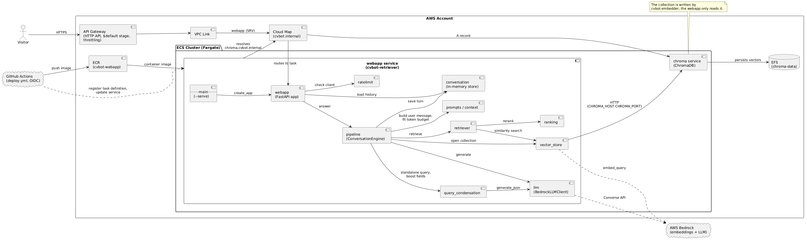
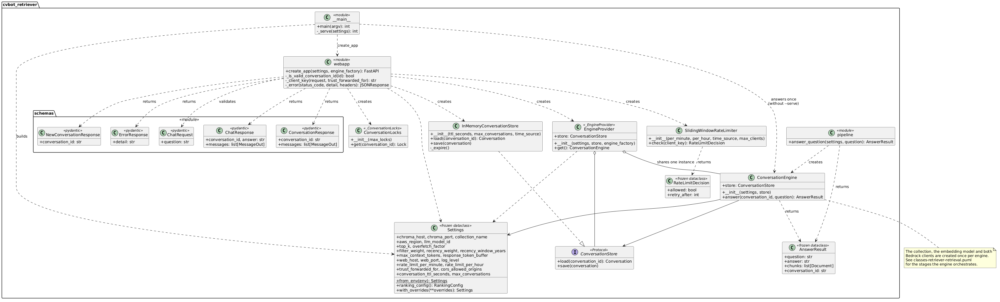
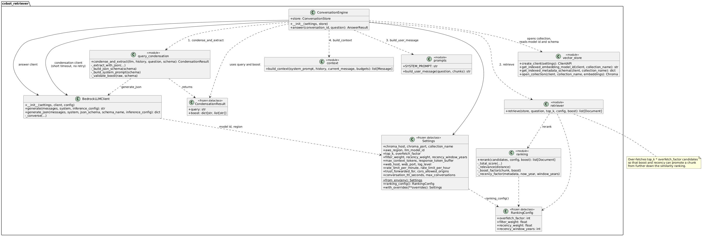
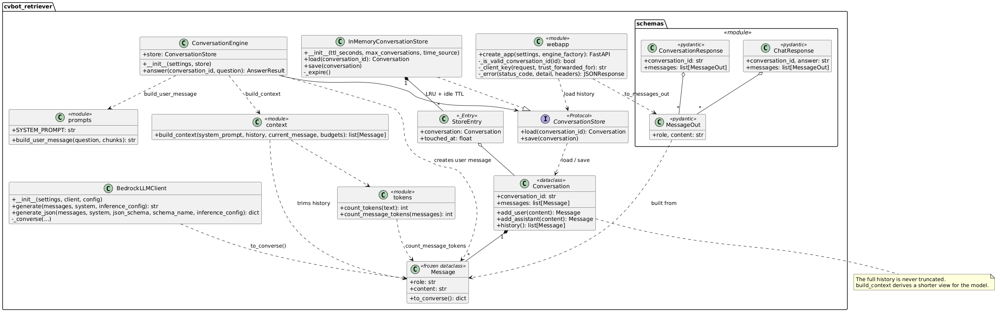
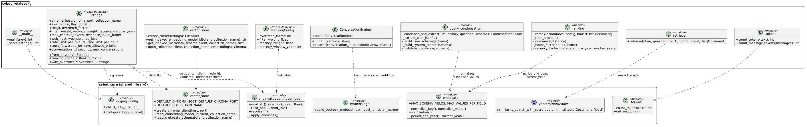
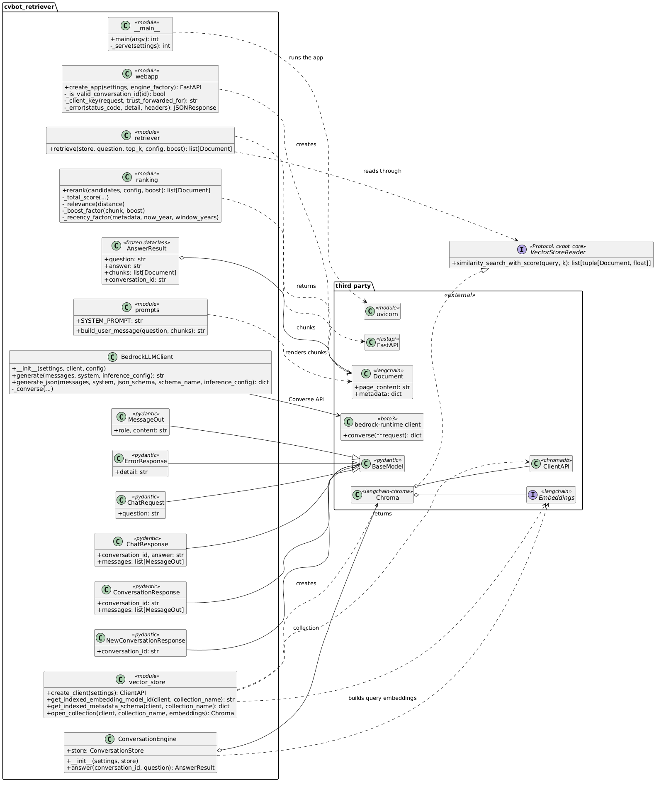
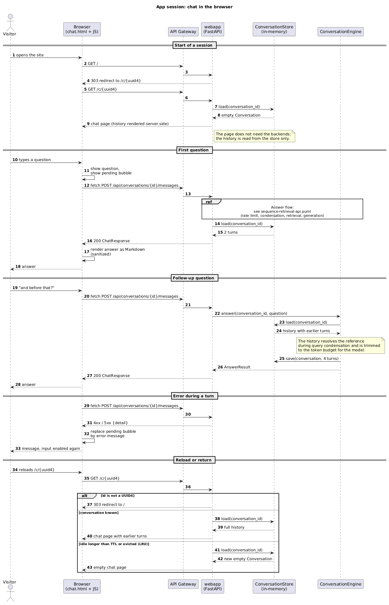
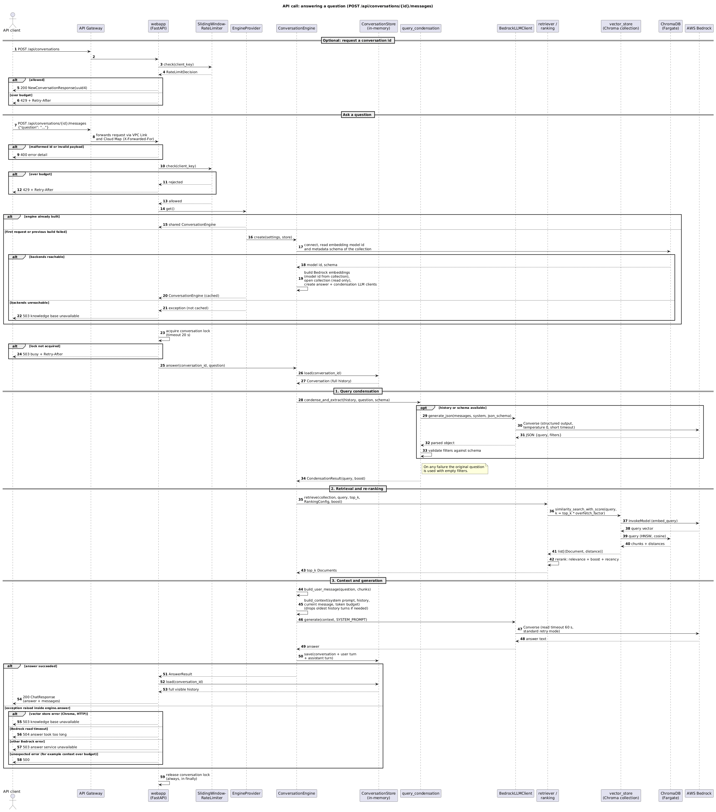

# cvbot-retriever

Retrieval and generation service of the CVBot RAG system: a FastAPI chat app that answers questions about a CV from the ChromaDB collection built by cvbot-embedder.

## Overview

CVBot is a personal RAG chatbot that answers questions about its owner's career. This repository contains the query side: it condenses the question, extracts metadata filters, retrieves and re-ranks chunks from ChromaDB and generates the answer with a Bedrock LLM. A small web UI and a JSON API keep a multi-turn conversation per visitor.

**Tools:** Python 3.13, FastAPI, uvicorn, Jinja2, Pydantic, LangChain (`langchain-core`, `langchain-aws`, `langchain-chroma`), ChromaDB client, boto3 (Bedrock Converse API), tiktoken, cvbot-core, Docker

**AWS components:**

| Component | Role |
| --- | --- |
| Bedrock | Embeds the question (Titan Text Embeddings V2) and generates the answer (Claude Haiku 4.5). |
| ECS Fargate (webapp service) | Runs this application as a single task. |
| ECS Fargate (chroma service) | Runs ChromaDB, which this application only reads. |
| API Gateway (HTTP API) + VPC Link | Public HTTPS entry point with global throttling. |
| Cloud Map | Private DNS for the webapp (SRV) and ChromaDB (A record). |
| ECR | Stores the container images. |

The infrastructure itself is provisioned by cvbot-infra.

## Design decisions

The system is a proof of concept and a showcase: it does not need to be production ready or permanently online, should balance own code against managed services, and should be as cheap as possible. That leads to several deviations from a typical RAG application:

| Typical RAG setup | Here | Reason |
| --- | --- | --- |
| Separate LLM calls to rewrite the question and to extract filters | One structured-output Converse call returns the standalone query and the filters | Saves a call per question; the JSON schema forces valid output. |
| Filter fields configured in the application | The filterable schema is read from the collection metadata published by cvbot-embedder | Retriever and index cannot drift apart; the model can only name fields and values that exist. |
| Metadata filters exclude non-matching chunks | Filters only add a capped score bonus | A wrong or empty filter degrades to plain semantic search instead of returning nothing. |
| Ranking by vector similarity alone | Own re-ranking: similarity, filter bonus and recency bonus, over-fetching `TOP_K * OVERFETCH_FACTOR` candidates | Questions about CV stations favor recent and matching sections; recency is computed at query time, so no re-indexing is needed. |
| Embedding model configured in the retriever | Model ID is read from the collection metadata | Query and chunk vectors always come from the same model. |
| Framework conversation memory, database or cache | Own `Conversation` model with an in-memory store (idle TTL, LRU) | Nothing to operate or pay for; conversations are not meant to be persisted. |
| Fixed number of history messages | Own context budget: oldest history turns are dropped until the context fits | Predictable token usage without silently truncating the current question. |
| Self-hosted models or an agent framework | Managed Bedrock models; LangChain only for embeddings and the Chroma wrapper | Own code only where it differentiates the system. |

## Limitations

- Conversations live in the memory of one task: they are lost on restart or deployment, after the idle TTL (30 minutes) and when evicted beyond the maximum of 50.
- Exactly one task can run. The conversation store, the conversation locks and the rate limiter are process-local and cannot be shared across instances.
- No high availability: a single ChromaDB instance, and the collection is rebuilt by cvbot-embedder, so it can be empty or partial while a run is in progress.
- Condensation is best effort: on any failure the raw question is used without filters.
- Token counting uses `cl100k_base` with a safety factor as an approximation of the Bedrock tokenizers.
- No authentication, WAF or streaming of answers. The user-facing messages are in German.

## Security

The app is public and every answer costs Bedrock calls, so usage is limited in several layers:

- **Rate limiting per client:** sliding minute and hour windows (default 10 and 60 answers); excess requests get `429` with `Retry-After` before any Bedrock call. The client is identified by `X-Forwarded-For`, which is only trusted when `TRUST_FORWARDED_FOR` is set (required behind API Gateway).
- **Gateway throttling:** API Gateway caps the total request rate and burst; configured in cvbot-infra.
- **Input and state bounds:** questions are limited to 2000 characters, conversation IDs must be UUID4, one request per conversation runs at a time (lock timeout 20 s), and idle or surplus conversations are dropped.
- **Cost bounds in the model call:** the context is limited by `MAX_CONTEXT_TOKENS`, the answer call has a 60 s read timeout, and the optional condensation call a short timeout without retry.
- **Prompt injection:** the system prompt treats retrieved chunks and the question as data; delimiter sequences are stripped from both.
- **Data hygiene:** logs contain metadata only, never questions or answers; CORS is same-origin unless origins are configured explicitly.

## Architecture

| Module / class | Purpose |
| --- | --- |
| `__main__` | Command line entry point; builds `Settings`, then either serves the web app via uvicorn or answers a single question. |
| `webapp` | FastAPI app factory with the UI and JSON endpoints; applies rate limiting, locking, validation and error mapping. |
| `EngineProvider` | Builds the `ConversationEngine` on first use and shares one instance; a failed build is not cached. |
| `ConversationLocks` | Hands out one lock per conversation so turns of the same conversation run one after another. |
| `Settings` | Frozen dataclass with the validated configuration, read from environment variables. |
| `RankingConfig` | Frozen dataclass with the re-ranking parameters (over-fetch factor, weights, recency window). |
| `pipeline` | Module with `answer_question` for a single question without history. |
| `ConversationEngine` | Orchestrates one turn: condensation, retrieval, context building, generation and saving the conversation. |
| `AnswerResult` | Frozen dataclass with the answer, the used chunks and the conversation ID. |
| `query_condensation` | Rewrites the question into a standalone query and extracts schema-validated metadata filters in one call. |
| `CondensationResult` | Frozen dataclass with the standalone query and the filter boost. |
| `retriever` | Reads the over-fetched candidates with their distances from the collection and returns the best `TOP_K` after re-ranking. |
| `ranking` | Scores candidates by similarity, filter match and recency. |
| `context` | Builds the model context within the token budget by dropping the oldest history turns. |
| `prompts` | Holds the system prompt and renders chunks and question into the delimited user message. |
| `BedrockLLMClient` | Wrapper around the Bedrock Converse API for plain text and structured JSON output. |
| `ConversationStore` | Protocol for loading and saving conversations. |
| `InMemoryConversationStore` | Process-local store with idle TTL and least-recently-used eviction. |
| `StoreEntry` | Internal store record of a conversation with its last access time. |
| `Conversation` | Full, never truncated message history of one conversation. |
| `Message` | Frozen dataclass of one user or assistant turn; converts itself to the Converse format. |
| `tokens` | Counts tokens of text and messages, including a safety factor. |
| `SlidingWindowRateLimiter` | Limits answered questions per client over a minute and an hour window. |
| `RateLimitDecision` | Frozen dataclass with the verdict and the retry delay. |
| `vector_store` | Opens the ChromaDB client and collection and reads the indexed embedding model ID and metadata schema. |
| `schemas` | Pydantic models and helpers of the JSON API. |
| `ChatRequest` | Request body with the question. |
| `ChatResponse` | Response with the answer and the visible messages. |
| `ConversationResponse` | Response with the visible history of a conversation. |
| `NewConversationResponse` | Response with a newly issued conversation ID. |
| `MessageOut` | One visible message in API responses. |
| `ErrorResponse` | Error body with a user-presentable message. |

The application and the engine; the web layer, rate limiting and the engine's collaborators:

The stages the engine orchestrates for one question: condensation, retrieval with re-ranking, prompt building and generation:

Conversation history, the store and the messages that flow into the context, the LLM client and the API schemas:

Which parts of cvbot-core the retriever builds on:

Which third-party libraries the retriever builds on:

## Workflow

1. The request passes the rate limiter, the validation of the conversation ID and the question, and the per-conversation lock.
2. On the first request the engine is built: it reads the embedding model ID and the metadata schema from the ChromaDB collection and opens the collection read-only.
3. The conversation is loaded from the store.
4. One structured-output call condenses the question into a standalone query and extracts metadata filters, which are validated against the published schema.
5. The query is embedded with the model the collection was built with, and `TOP_K * OVERFETCH_FACTOR` nearest chunks are read.
6. The candidates are re-ranked by similarity, filter bonus and recency bonus and cut to `TOP_K`.
7. The chunks and the question are rendered into the user message and the context is fitted into the token budget.
8. The Bedrock LLM generates the answer, and the new turns are saved to the conversation.
9. The visible history is returned. Failures are mapped to `400`, `429`, `503`, `504` or `500` with a user-presentable message.

The chat session in the browser, from opening the page to reloading it:

The API call that answers a question:

## Setup

1. **Infrastructure and index:** provision cvbot-infra and run the cvbot-embedder pipeline first, so the ECS services, the ECR repository, the deploy role and the ChromaDB collection exist.
2. **AWS access:** the workflows request `permissions: id-token: write` and assume the role from `AWS_DEPLOY_ROLE_ARN` via OIDC. No AWS keys are stored in this repository.
3. **Variables:** after the infrastructure apply, copy the created resource names and URLs into the repository variables listed below.
4. **Diagram push:** the `render-diagrams` job commits the rendered `docs/*.png`. Register a GitHub App, install it on this repository with the **Contents: Read and write** permission and store its credentials as repository secrets **`APP_ID`** and **`APP_PRIVATE_KEY`** (same approach as in cvbot-core).
5. **Bedrock:** enable model access to Titan Text Embeddings V2 and Claude Haiku 4.5 (`eu.*` inference profile) in the target region.
6. **First start:** run the workflow *Build and deploy web app* once to push the first image, then *Start or stop web app* with `start`.

## Environment variables

Set as GitHub repository **variables** unless marked as secret. The workflows define no defaults, so all of them are **required**. Variables marked **shared** must be set identically in the named repository. The runtime settings of the container (e.g. `TOP_K`, `RATE_LIMIT_PER_MINUTE`, `CHROMA_COLLECTION`) are not set here: they are set through the `WEBAPP_*` variables of cvbot-infra and have code defaults.

| Name | Purpose | Shared |
| --- | --- | --- |
| `AWS_REGION` **required** | Region of ECR, ECS and Bedrock. | **shared** with cvbot-infra and cvbot-embedder |
| `AWS_DEPLOY_ROLE_ARN` **required** | Role assumed via OIDC to push images and manage the services. | **shared** with cvbot-embedder |
| `ECR_REPOSITORY` **required** | ECR repository the image is pushed to (`cvbot-webapp`). | |
| `ECS_CLUSTER` **required** | ECS cluster that hosts both services. | **shared** with cvbot-embedder |
| `ECS_WEBAPP_SERVICE` **required** | Web app service that is deployed and scaled (`cvbot-webapp-service`). | |
| `ECS_TASK_FAMILY` **required** | Task definition family that receives the new image (`cvbot-webapp`). | |
| `ECS_CHROMA_SERVICE` **required** | ChromaDB service that is started and stopped together with the web app. | **shared**: equals `ECS_SERVICE` in cvbot-embedder |
| `WEBAPP_API_URL` **required** | Public API Gateway URL, probed at `/healthz` after a start. | |
| `APP_ID` (secret) **required** | ID of the GitHub App that pushes the rendered diagrams. | |
| `APP_PRIVATE_KEY` (secret) **required** | Private key of that GitHub App. | |
